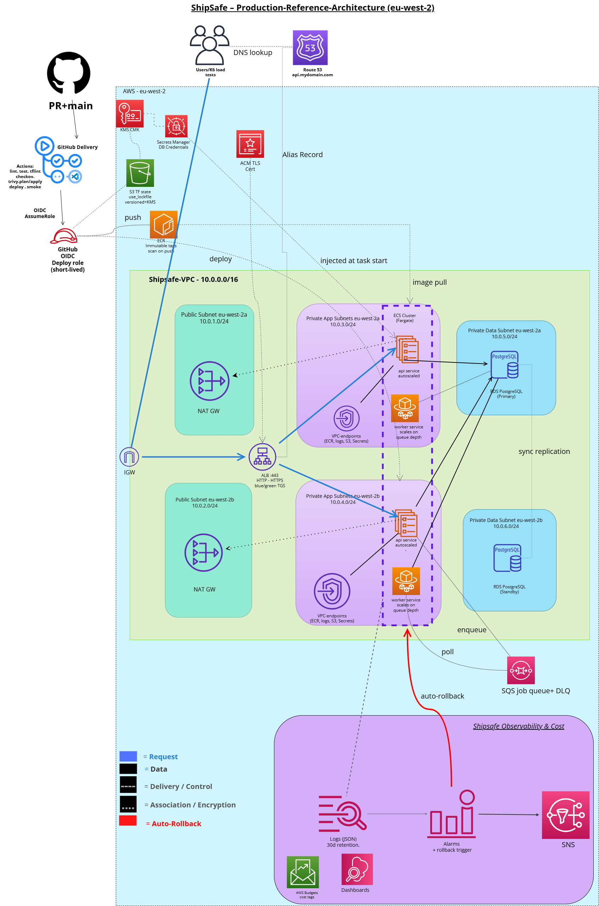

# ShipSafe

A production-style AWS ECS Fargate delivery platform: secure CI/CD with GitHub OIDC, automatic failure detection and rollback, progressive delivery, SLO-based observability and cost controls. Built in public, milestone by milestone.

> Portfolio project, not a commercial production workload.

## Status

- [x] Architecture design
- [ ] M1: Secure foundations (remote state, budgets, OIDC)
