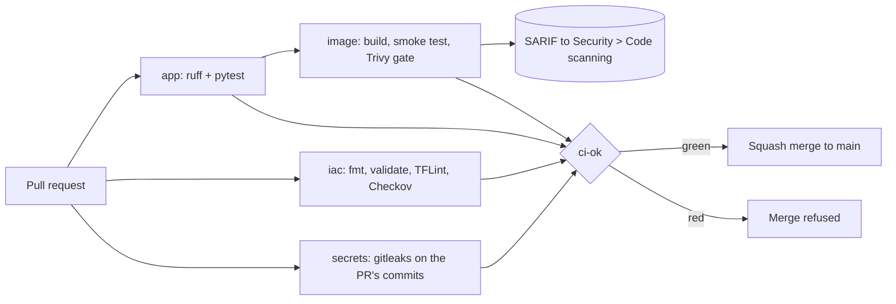

# CI/CD: how a change reaches `main`

> Scope: M2 covers the CI gates only. Deployment (CD) to AWS arrives in M5.
> ShipSafe is a portfolio project, not a commercial production workload.

## The rule

Nothing reaches `main` except through a pull request whose `ci-ok` check is green.
The `protect-main` repository ruleset enforces this, and it has **no bypass actors**, so it applies to admins too.

## Pipeline



| Job | Checks | Fails when | Typical time |
|---|---|---|---|
| `app / lint + test` | `uv sync --locked`, `ruff check` (incl. bandit `S` rules), `ruff format --check`, `pytest` | lockfile drift, lint or security rule, unformatted code, failing test | ~10-15 s |
| `iac / terraform + checkov` | `terraform fmt -check`, `validate`, TFLint, Checkov | formatting, invalid config, lint finding, unjustified Checkov finding | ~40-60 s |
| `secrets / gitleaks` | PRs: only the commits the PR adds. `main`: full history | any secret-shaped string | ~5-7 s |
| `image / build + smoke + scan` | build; run with `--read-only`, `--cap-drop ALL`, `no-new-privileges`; assert `/healthz`, `/version` = commit SHA, UID 10001; Trivy | image won't start, wrong version or user, CRITICAL or fixable HIGH | ~35-45 s |
| `ci-ok` | aggregates the jobs above | any job did not succeed (failed **or skipped**) | ~3 s |

The ruleset requires only `ci-ok`, pinned to the GitHub Actions app (`integration_id` 15368), so a status posted by any other app or token cannot satisfy it. Jobs can be added or renamed without touching the ruleset.

## Vulnerability gate policy

- **Block:** CRITICAL, or HIGH **with a fix available** (`trivy --ignore-unfixed --exit-code 1`).
- **Track:** all findings are uploaded as SARIF to **Security > Code scanning** (`tool:Trivy`).
- **Why not CRITICAL-only:** gate test D added `cryptography==3.3.1`. Trivy reported 5 HIGH and 0 CRITICAL, all fixable. A CRITICAL-only gate would have merged it.
- **Unfixed OS findings** (Debian packages with no fix released yet) are tracked, not blocked. At the end of M2: 44 open alerts covering 8 distinct CVEs. Trivy reports one alert per affected binary package, so one util-linux CVE appears up to 9 times. Exploiting these needs local shell access, privileged mounts, or the app processing untrusted input with these tools. The app does none of that and runs as UID 10001 with no Linux capabilities and a read-only root filesystem. This reduces the risk; it does not remove it. The alerts close by themselves when Dependabot's base-image digest updates bring the Debian fixes in. A distroless or Wolfi base is the M10 option for removing the packages entirely.

## Supply chain controls

- Actions allow-list: `allowed_actions=selected`, 5 patterns, `github_owned_allowed=false`.
- `sha_pinning_required=true`: every action is referenced by full commit SHA.
- Default `GITHUB_TOKEN` is read-only; jobs opt in (`image` gets `security-events: write`, `oidc-check` gets `id-token: write`).
- Scanner and linter binaries are downloaded at pinned versions and checksum-verified. No third-party wrapper actions (see the Trivy v0.69.4 compromise, CVE-2026-33634).
- Base images are pinned by digest.
- Dependabot runs weekly for GitHub Actions, uv and Docker. Python stays on `3.12-slim` (digest updates only); a Python minor upgrade is a deliberate change with its own ADR.

## Secrets: three layers

1. **pre-commit gitleaks** (local). Fast, but `git commit --no-verify` bypasses it.
2. **GitHub secret scanning and push protection** (server side, all branches).
3. **CI gitleaks** (the merge gate).

Gate test C: layers 1 and 3 caught a fake AWS key ID. Push protection did not block it; a lone key ID without its secret is a low-confidence pattern.

The PR scan covers only the PR's own commits. Gate test D showed that scanning `--all` let a leak on one branch fail an unrelated PR. Scanning across all branches remains the job of GitHub secret scanning.

## Run the gates locally

```bash
cd app && uv sync --locked && uv run ruff check . && uv run ruff format --check . && uv run pytest -q && cd ..
pre-commit run --all-files
docker build --build-arg APP_VERSION=$(git rev-parse --short=7 HEAD) -t shipsafe:local app
trivy image --severity HIGH,CRITICAL --ignore-unfixed shipsafe:local
```

## When a gate fails

- Fix the cause. If a finding is a false positive or an accepted risk, suppress it **inline with a reason** (for example `#checkov:skip=ID:reason`); never loosen the gate.
- There is no Trivy ignore file. Adding one requires an ADR with an expiry date.
- `--admin` merges are not available: the ruleset has no bypass actors.
